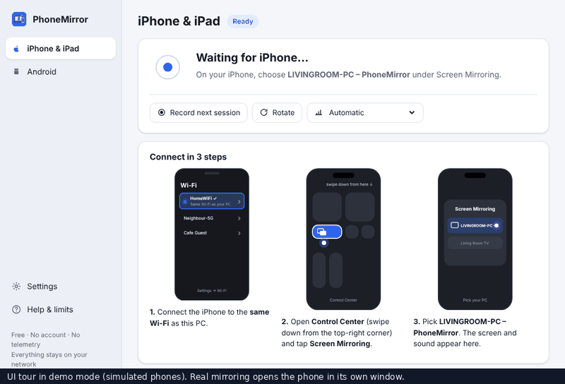

# PhoneMirror

**Show any phone's screen on your PC. Free: no watermark, no time limit, no account.**

* **Android:** see it, hear it, and control it with your mouse and keyboard.
* **iPhone & iPad:** see it and hear it. (Apple doesn't allow controlling an iPhone from a PC.)

Paid apps charge for this. The free engines that do the real work already exist,
[scrcpy](https://github.com/Genymobile/scrcpy) for Android and
[UxPlay](https://github.com/FDH2/UxPlay) for iPhone (AirPlay), but they're hard
to set up. PhoneMirror packs them into one installer and a few taps.

[](https://github.com/AnIntellectualBeing/TOOL1/actions/workflows/build.yml)
&nbsp;Windows 10/11 · GPL-3.0 · no telemetry



<sub>The GIF is a tour of the interface in demo mode (simulated phones). On a real
PC the phone's picture opens in its own window next to PhoneMirror.</sub>

---

## Download

Get `PhoneMirror_x.y.z_x64-setup.exe` from the
[Releases page](https://github.com/AnIntellectualBeing/TOOL1/releases) and run it.
Everything PhoneMirror needs is inside; you don't install anything else.

> **Windows may say “Windows protected your PC”.** The installer isn't
> code-signed yet. Click **More info → Run anyway**. You can compare the file
> with `SHA256SUMS.txt` on the release page.

During installation Windows asks for permission once: PhoneMirror adds two
firewall rules so phones on your **home or work network** can reach it (see
[Firewall, in plain words](#firewall-in-plain-words)).

## Quick start

### iPhone or iPad (3 steps)

1. Open PhoneMirror. It says **Waiting for iPhone…** and shows your PC's name,
   e.g. *DESKTOP-4FQ2 – PhoneMirror*.
2. On the iPhone, connected to the **same Wi-Fi**, open **Control Center**
   (swipe down from the top-right corner) and tap **Screen Mirroring**.
3. Pick **DESKTOP-4FQ2 – PhoneMirror**. The screen and sound appear.

To stop, tap **Stop Mirroring** on the iPhone.

**Use your PC as a speaker:** in Music, Podcasts or Control Center, tap the
AirPlay icon and choose your PC. Turn on *Sound only* in PhoneMirror if you
don't want a picture window.

### Android (3 steps, the first time)

1. In PhoneMirror go to **Android → Add a phone** and pick your brand
   (Samsung, Xiaomi/Redmi/POCO, Vivo, OPPO/Realme, OnePlus, Motorola, Pixel or
   Other). The wizard shows pictures of the menus on your phone.
2. Turn on **Developer options** (tap *Build number* 7 times) and then
   **Wireless debugging**, and tap **Pair device with QR code**.
3. Scan the QR code PhoneMirror shows. Done: the phone is remembered.

**Every time after that:** press **Connect** next to your phone. That's it.

**USB cable instead:** turn on *USB debugging*, plug the phone in, tap
*Allow* on the phone, then press **Mirror**. This also works on Android 10
and older, which can't pair wirelessly.

## What you can do

| | Android | iPhone / iPad |
|---|---|---|
| See the screen | ✅ | ✅ |
| Hear the sound | ✅ Android 11+ | ✅ |
| Control with mouse & keyboard | ✅ | ❌ Apple doesn't allow it |
| Connect over Wi-Fi | ✅ QR pairing, then one click | ✅ AirPlay |
| Connect with a USB cable | ✅ | — |
| Fullscreen, always on top, rotate | ✅ | ✅ (rotate applies to the next session) |
| Screenshot | ✅ full phone resolution | ✅ of the picture window |
| Record to MP4 | ✅ | ✅ from the next session |
| Sound on/off, quality presets | ✅ | ✅ |
| Drag & drop files (APKs get installed) | ✅ to the phone's *Download* folder | — |
| Shared clipboard (copy on one, paste on the other) | ✅ | — |
| Keep the phone's screen off to save battery | ✅ | — |
| Use the phone's camera | ✅ Android 12+, in a window | — |
| Phone camera as a webcam in Zoom/Teams | ❌ not yet (see FAQ) | — |
| PC as an AirPlay speaker | — | ✅ |
| Cast videos from apps (YouTube) | — | ✅ experimental |
| Reconnects automatically if the connection drops | ✅ | ✅ (receiver restarts itself) |

## Honest limits

* **An iPhone can't be controlled from the PC.** Apple doesn't allow it.
* **Phone and PC must be on the same Wi-Fi.** Some public, hotel, school or
  office Wi-Fi blocks devices from seeing each other. A phone hotspot works:
  connect the PC to it.
* **Protected apps show a black screen** (Netflix, some banking apps). That's
  the app's choice.
* **Android sound needs Android 11 or newer.** Wireless pairing also needs
  Android 11+; older phones work over USB.
* **The installer isn't code-signed yet**, so SmartScreen may warn.
* For now the phone's picture opens in its own window (scrcpy's or UxPlay's)
  rather than inside PhoneMirror.
* The phone camera works in a window, but **doesn't yet show up as a webcam**
  in other Windows apps.

## Troubleshooting

**My iPhone doesn't list the PC under Screen Mirroring**
1. Both on the same Wi-Fi? Not a guest network, and not one on 5 GHz and the
   other on a separate 2.4 GHz network.
2. In PhoneMirror: **Settings → Network & firewall → Fix firewall**.
3. If Windows calls your Wi-Fi *Public*, set it to *Private* (Windows Settings →
   Network & internet → Wi-Fi → your network) or press **Allow on this network**.
4. Turn the iPhone's Wi-Fi off and on. Still nothing? Try a phone hotspot to
   rule out the router.

**“Your phone and PC are on different Wi-Fi networks”**
PhoneMirror compared the phone's address with your PC's and they're on
different networks. Put both on the same one.

**“We can't find your phone on this Wi-Fi”** (Android)
Wireless debugging switches itself off after a restart or when the phone
changes Wi-Fi. Turn it on again: Settings → Developer options → Wireless debugging.

**“Your phone doesn't recognise this PC anymore”**
The phone's pairing list was cleared. Pair again with **Add a phone**.

**The QR code won't scan**
Use the scanner inside *Wireless debugging → Pair device with QR code*, not
the camera app. Or press **Pair with a code instead** and type the address and
6-digit code the phone shows.

**I can see the Android screen but can't click**
Xiaomi/Redmi/POCO: turn on **USB debugging (Security settings)** in Developer
options and restart the phone. OPPO/Realme: turn on **Disable permission
monitoring**.

**No sound from Android**
Needs Android 11+. On Android 11, unlock the phone before connecting.

**Black or choppy picture**
Choose a lower quality preset. For iPhone try **Settings → Video output →
Compatible**. A black picture in protected apps is expected.

**Still stuck?** **Settings → Copy diagnostics** and paste it into a
[new issue](https://github.com/AnIntellectualBeing/TOOL1/issues). It contains
logs and network details, no personal files.

## FAQ

**Is it really free?** Yes. No ads, no account, no watermark, no time limit.
It's open source (GPL-3.0).

**Does anything leave my network?** No. There's no telemetry or analytics,
and PhoneMirror doesn't contact the internet. The picture and sound go
directly from your phone to your PC. Two exceptions, both visible to you: if
you turn on **Cast videos from apps** (off by default), the PC fetches that
video from YouTube itself, as the iPhone asked; and if the WebView2 component
is missing, the installer downloads it from Microsoft (on Windows 10/11 it's
almost always already there).

**Why does Android need “Developer options”?** Mirroring and control go
through adb, Android's official debugging connection. It's only reachable
from computers you've paired, and you can turn it off any time.

**Is Wireless debugging safe?** Only computers that scanned your QR code (or
typed the pairing code) can connect. To remove access: Developer options →
*Revoke USB debugging authorisations*.

**Can I use the phone camera as a webcam in Zoom/Teams?** Not yet. PhoneMirror
can show the camera (Android 12+) in a window. Making it a system webcam on
Windows needs a virtual camera driver, which isn't done. On Linux, scrcpy's
`--v4l2-sink` can do it.

**Why is the installer about 60 MB?** It includes the GStreamer/FFmpeg
runtime the iPhone receiver needs, so you don't install anything else.

**Mac and Linux?** The code is written to be portable (engine paths, window
helpers and the firewall are behind small platform modules), but only Windows
is built and tested right now.

## Firewall, in plain words

* iPhones **find** the PC by asking the local network “who can receive
  AirPlay?” (mDNS, UDP port 5353). PhoneMirror's receiver answers.
* The iPhone then **sends** the picture and sound to the receiver on ports
  **7100–7102** (TCP and UDP).
* For Android pairing, PhoneMirror **listens** for phones announcing themselves
  (mDNS, UDP 5353). Mirroring itself is an outgoing connection from the PC.

The installer allows exactly that, only for PhoneMirror's own programs, and
only on **Private** (home) and **Domain** (work) networks. Public networks
aren't opened unless you press **Allow on this network**. Home routers don't
forward these ports, so nothing is reachable from the internet. Uninstalling
removes the rules.

## How it works

```
 iPhone ──AirPlay──▶ UxPlay (bundled, built-in mDNS) ──▶ GStreamer window
 Android ──adb──▶ scrcpy (bundled with adb) ──▶ SDL window, mouse/keyboard back to phone
                    ▲
 PhoneMirror (Tauri: Rust + web UI)
   • starts/stops/supervises the engines, restarts them if they crash
   • wireless pairing: shows WIFI:T:ADB;S:<name>;P:<password>;; as a QR,
     finds the phone via mDNS (_adb-tls-pairing._tcp), runs adb pair, then
     finds _adb-tls-connect._tcp and runs adb connect; remembers the phone
   • reads engine logs to show status and plain-language errors
   • screenshots (adb screencap / window capture), recording (scrcpy --record,
     UxPlay -mp4), mute/always-on-top/fullscreen via the Windows API
```

* `crates/core` – all the logic that can be unit-tested without phones:
  pairing and reconnection (with mock adb and mock mDNS), adb output parsing,
  engine command lines, log interpretation, firewall checks, error messages.
* `src-tauri` – the desktop app: processes, mDNS, Windows integration.
* `ui` – the interface (plain HTML/CSS/JS). Open `ui/index.html` in a browser
  to try it in demo mode.
* `scripts` – fetching scrcpy, building/bundling UxPlay, checks.

Building from source: see [BUILDING.md](BUILDING.md). Testing on real phones:
see [docs/TESTING.md](docs/TESTING.md).

## Credits

PhoneMirror is a friendly front end. The hard work is done by:

* **[scrcpy](https://github.com/Genymobile/scrcpy)** by Genymobile and Romain
  Vimont: Android mirroring and control (Apache-2.0).
* **[UxPlay](https://github.com/FDH2/UxPlay)** by F. Duncanh and contributors,
  building on RPiPlay and shairplay: the AirPlay receiver (GPL-3.0).
* **[GStreamer](https://gstreamer.freedesktop.org/)** and
  **[FFmpeg](https://ffmpeg.org/)**: decoding and playback.
* **adb** from the Android Open Source Project.
* **[Tauri](https://tauri.app/)**, **[mdns-sd](https://github.com/keepsimple1/mdns-sd)**
  and the other Rust crates listed in [THIRD_PARTY_LICENSES.md](THIRD_PARTY_LICENSES.md).

## License

PhoneMirror is free software under the [GNU GPL v3.0 or later](LICENSE).
Bundled components keep their own licences; see
[THIRD_PARTY_LICENSES.md](THIRD_PARTY_LICENSES.md).

AirPlay, iPhone and iPad are trademarks of Apple Inc. Android is a trademark of
Google LLC. PhoneMirror isn't affiliated with Apple, Google, scrcpy or UxPlay.
